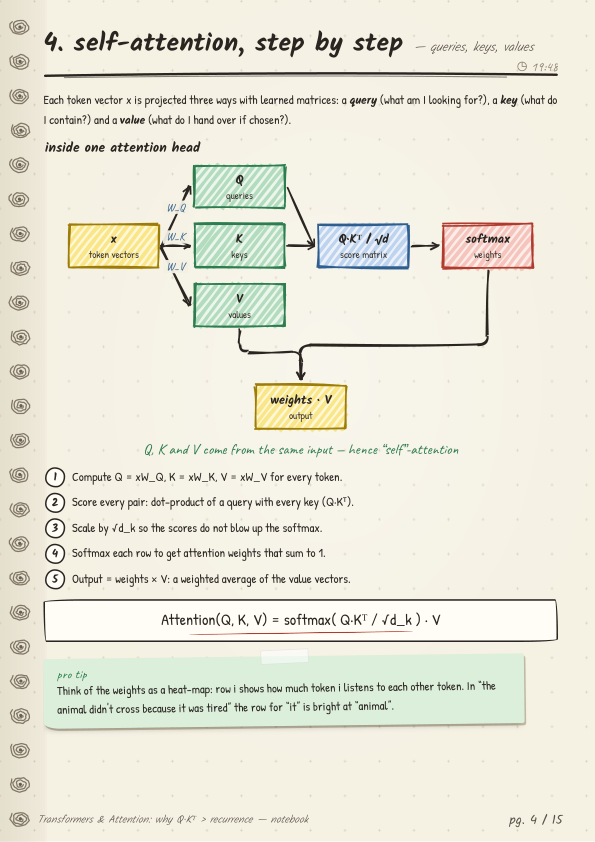
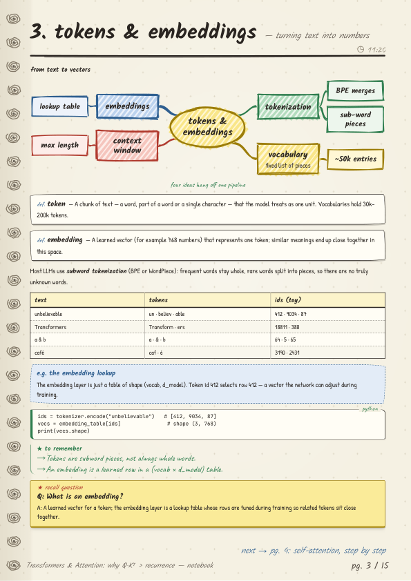
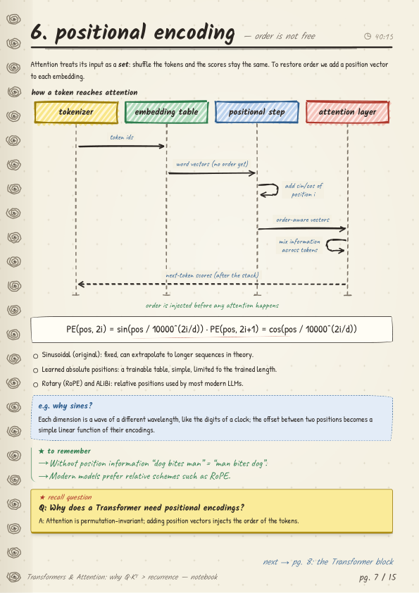

# Notes worker

The Python service that turns a YouTube lecture into **knowledge-only study notes**, drawn as a
hand-made "field notebook": cream ruled paper, spiral rings, sketchy diagrams, sticky recall
questions, a glossary and a one-page recap. It also analyses whole playlists ("smart playlist").

| Flow diagram | Mind map | Sequence diagram |
|---|---|---|
|  |  |  |

The worker is internal. It listens on `127.0.0.1:5055` only, and the Node API (`apps/api`) is the
only caller. The same engine can also be used from the command line or as a Python library.

## What it does

1. **Transcript** (`notes_engine/ingest.py`): captions from YouTube, else yt-dlp subtitles, else
   speech-to-text (local faster-whisper, or Groq Whisper with a Groq key).
2. **Notes** (`notes_engine/llm.py`): an AI provider writes the notes. Short lectures take one call;
   long ones use map-reduce (digest each slice, compose sections, write cover / glossary / recap).
   `notes_schema.validate_notes` turns whatever the model returns into valid Notes JSON.
3. **Rendering** (`notes_engine/render/`): Notes JSON becomes one self-contained HTML page, and
   headless Chrome/Chromium/Edge prints it as an A4 PDF.

Each request runs as a background job (two at a time). Its files are written to
`backend/output/<job_id>/` (`notes.json`, `notes.html`, `notes.pdf`) and deleted after 24 hours.
[docs/architecture.md](docs/architecture.md) explains the pipeline and every module.

## Run it

Everything is run from `apps/worker/`. Requirements: Python 3.10+ (the image uses 3.12), and
Chrome, Chromium or Edge for the PDF (without one you still get the HTML and JSON).

```bash
python -m venv .venv
.venv/bin/pip install -e ".[web,dev]"        # add ,whisper for local speech-to-text
cp backend/.env.example backend/.env         # fill in the keys you have
.venv/bin/python backend/run.py              # http://127.0.0.1:5055
```

In the full stack, `docker compose up --build` (from the repo root) runs the worker as the
`notes-ai` service. Its port is not published; the API container shares its network namespace.
Generated notes, the cache and scratch files are bind-mounted under `apps/worker/backend/`, and the
Whisper model under `.tools/whisper-models`.

Command line and library use, without the web server:

```bash
GROQ_API_KEY=... .venv/bin/python -m notes_engine "https://youtu.be/VIDEO_ID" --provider groq --out notes.pdf --html --json
.venv/bin/python -m notes_engine --list-providers
```

```python
import notes_engine

result = notes_engine.generate("https://youtu.be/VIDEO_ID", "groq", out_dir="out")
result["pdf_path"], result["html_path"], result["notes"]
```

CLI exit codes: `0` ok, `1` unexpected error, `2` bad usage or missing key, `3` transcript error,
`4` AI provider error, `5` notes written but no PDF (JSON and HTML saved), `130` interrupted.

## Test and lint

```bash
LNA_OFFLINE=1 .venv/bin/python -m pytest     # all tests; network and providers are mocked
.venv/bin/ruff check .                       # lint (rules in pyproject.toml)
.venv/bin/ruff format .                      # format (CI runs: ruff format --check .)
```

`LNA_OFFLINE=1` skips the one optional live-network test and the local server probe. PDF tests are
skipped when no browser is installed. Tests never call a real API.

## Folder map

```
backend/
  run.py                   entry point: cache + temp folders, key check, starts Flask
  .env.example             keys and settings (copy to .env; never commit it)
  app/                     the Flask app (routes, jobs, security); see app/server.py
  output/                  job files, cache, checkpoints (git-ignored)
notes_engine/              the engine package (pip-installable)
  __init__.py              generate(): the whole flow in one call
  __main__.py              command line
  ingest.py                YouTube -> transcript (helpers in transcripts/)
  llm.py                   transcript -> notes via an AI provider (helpers in ai/)
  prompts.py               prompt texts and JSON schemas sent to the model
  notes_schema.py          validate / repair the model's JSON
  smart_playlist.py        playlist analysis (profile, order, gaps)
  cache.py                 optional disk cache
  pdf.py                   render_html / render_pdf (code in render/)
  render/                  the notebook renderer
  templates/, static/      notebook CSS/JS, vendored Rough.js, fonts
tools/notes_eval/          provider evaluation harness (developer tool, has its own README)
tests/                     pytest suites
docs/                      architecture, Notes JSON schema, smart-playlist contract, images
```

## HTTP API

All routes return JSON errors as `{"error": "..."}`.

| Method | Path | Purpose |
|---|---|---|
| GET | `/api/providers` | `{providers: [{id, label, default_model, key_hint, needs_key, server_key, online?}]}` (`server_key` is a boolean) |
| POST | `/api/jobs` | `{url, provider, api_key?, model?, groq_key?}` -> `202 {job_id}` |
| GET | `/api/jobs/<id>` | `{job_id, status: queued/running/done/error, stage, pct, message, pages, error?, meta?, links?, warning?, chunk?, chunks?}` |
| GET | `/api/jobs/<id>/notes.json` | the structured notes ([docs/notes-schema.md](docs/notes-schema.md)) |
| GET | `/api/jobs/<id>/notes.pdf` | the PDF (download) |
| GET | `/api/jobs/<id>/notes.html` | the HTML preview |
| GET | `/api/jobs/<id>/draft.html` | live preview while the job runs: the pages finished so far (`pages` in the status) |
| POST | `/api/keys/test` | `{provider, api_key, model?}` -> `200 {ok: true}` or `{ok: false, kind: invalid/quota/network/other, error}`: one tiny real call to check a user's key (rate limited; the key is never logged or echoed) |
| GET | `/api/playlist?url=...` | the videos of a YouTube playlist (metadata only) |
| POST | `/api/smart` | start a smart-playlist analysis -> `202 {job_id}` ([contract](docs/smart-playlist-contract.md)); an optional `api_key` (the user's own, sent by the API) wins over the server key |
| GET | `/api/smart/<id>` | its progress and result |

## Environment variables

Keys go in `backend/.env` (loaded at start; a key typed in a request wins for `/api/jobs`).

| Variable | Default | Meaning |
|---|---|---|
| `GEMINI_API_KEY`, `GROQ_API_KEY`, `XAI_API_KEY`, `HF_TOKEN`, `NVIDIA_API_KEY` | | server-side provider keys |
| `LNAI_LOCAL_URL` | `http://127.0.0.1:8081/v1` | local llama-server (http, or https for a remote GPU server) |
| `LNAI_LOCAL_KEY` | | Bearer key for a remote local server |
| `LNAI_LOCAL_CTX` | asked from the server | context size; 8192 or less selects the small profile |
| `COLAB_LLM_URL`, `COLAB_LLM_KEY` | | deprecated `colab` provider (use `LNAI_LOCAL_URL` / `LNAI_LOCAL_KEY`) |
| `LNA_PROVIDER_FALLBACK` | off | `1` turns the provider fallback on (see below) |
| `LNAI_GROQ_FALLBACK_MAX_SEC` | `3600` | longest video sent to Groq as a fallback |
| `LNAI_GEMINI_RPM` | `10` | Gemini requests per minute for the pacer; `0` turns it off |
| `LNA_CACHE_DIR` | `backend/output/cache` (set by `run.py`) | disk cache of transcripts and accepted answers; unset = off |
| `LNA_CACHE_MAX_MB` | `300` | cache size limit (least recently used files go first) |
| `LNAI_CHECKPOINT_DIR` | | checkpoint folder for library / CLI use (the server passes its own) |
| `LNAI_WHISPER` | `auto` | speech-to-text: `auto`, `local`, `groq` or `off` |
| `LNAI_WHISPER_MODEL` | `small` | faster-whisper model |
| `LNAI_WHISPER_DIR` | `<repo>/.tools/whisper-models` | where the Whisper model is downloaded |
| `LNAI_WORK_DIR` | `backend/output/_cache` | speech-to-text checkpoints |
| `FFMPEG_PATH` | `ffmpeg` on `PATH` | ffmpeg for splitting audio |
| `LNAI_BROWSER` | first browser found | browser used to print the PDF |
| `LNA_PORT` | `5055` | server port (always bound to 127.0.0.1) |
| `LNA_TMP_DIR` | `backend/.tmp` | scratch files (audio, browser profiles) |
| `LNA_OFFLINE` | | `1` in tests: no live network test, no local server probe |

## Providers and fallback

| Provider | Default model | Key | Notes |
|---|---|---|---|
| `local` | `qwen3-8b` | none | llama-server; "local" or "local-small" size profile by context size |
| `gemini` | `gemini-3.5-flash-lite` | `GEMINI_API_KEY` | large context; parallel single pass; request pacer |
| `groq` | `openai/gpt-oss-120b` | `GROQ_API_KEY` | free tier is tokens-per-minute limited, so calls are small and paced; the key also powers Whisper |
| `xai` | `grok-4` | `XAI_API_KEY` | paid |
| `huggingface` | `meta-llama/Llama-3.3-70B-Instruct` | `HF_TOKEN` | token needs *Inference Providers* permission |
| `nvidia` | `nvidia/nemotron-3.5-super-vl-120b-a12b` | `NVIDIA_API_KEY` | large context, no daily token cap |
| `colab` | `qwen3-8b` | `COLAB_LLM_KEY` | deprecated alias of `local` |

With `LNA_PROVIDER_FALLBACK=1`, a rate limit, 5xx, timeout or unreachable local server retries the
**whole video** once with another provider, using server-side keys only:

| Primary | Fallback order |
|---|---|
| `local` (or `colab`) | Groq for videos up to `LNAI_GROQ_FALLBACK_MAX_SEC` (1 h), otherwise NVIDIA |
| any other | `local` if it is online, then Groq (videos up to 1 h), then NVIDIA |

Groq is capped at one hour because a longer lecture does not fit its free tokens-per-minute budget.
Answers from a fallback provider are never written to the shared cache, and the notes record the
provider used in `meta.provider` / `meta.fallback_from`. Size limits per provider and model are
explained at the top of `notes_engine/ai/providers.py`.

## How to add a feature

Keep to three habits: put the change where the matching module already lives (the folder map
above), add a test next to the existing ones in `tests/`, and run tests and ruff before you push.

### Example 1: add a new AI provider

Say the provider is "Acme" with an OpenAI-compatible chat API.

1. `notes_engine/ai/providers.py`
   - add `"acme"` to `PROVIDERS` (`label`, `default_model`, `needs_key: True`, `key_hint`);
   - add its chat URL to `ENDPOINTS`;
   - add a size profile to `BASE_PROFILES` (copy the closest provider and adjust `single_chars`,
     `chunk_chars`, output tokens and `tpm`; the comments above it explain each key). Add a model
     override in `_apply_model_overrides` only if one model needs different numbers.
2. `notes_engine/ai/key_safety.py`: add the key's shape to `KEY_PATTERNS`, so it is scrubbed from
   every error message.
3. Key names, in three places: `ENV_KEYS` in `backend/app/settings.py` (server key), `SERVER_KEY_ENV`
   in `notes_engine/llm.py`, and `ENV_KEYS` in `notes_engine/__init__.py` (CLI and library). Add the
   variable to `backend/.env.example`, and to `KEY_VARS` in `backend/app/keycheck.py` if you want the
   startup check.
4. `backend/app/settings.py`: add the provider to `FALLBACK_PROVIDERS` and `PROVIDER_ORDER` (the
   order of `GET /api/providers`).
5. Only if the API is *not* OpenAI-compatible: add a branch to `_Client.build_request` and
   `_Client._extract` in `notes_engine/llm.py` (Gemini is the example to follow).
6. Tests: add the provider to the parametrised request-shape test in `tests/test_llm.py` and update
   the provider list asserted in `tests/test_api.py`.
7. Docs: the provider table above.

The web app lists providers from `GET /api/providers`, so it needs no change.

### Example 2: add a new notes block type

Say the type is `quote` (`{"type": "quote", "text": str, "by": str}`).

1. `notes_engine/notes_schema.py`: add `"quote"` to `BLOCK_TYPES`, any spellings models use to
   `_BLOCK_ALIASES`, and a branch in `_coerce_block` that cleans the fields and returns `None` when
   the block is empty.
2. `notes_engine/prompts.py`: mention the type in `RULES` (when to use it), add it to the `type`
   enum of `_BLOCK_SCHEMA` (plus any new field, such as `by`, to its properties), and bump
   `PROMPT_VERSION` so cached answers and checkpoints made with the old prompt are not reused.
3. `notes_engine/render/blocks.py`: write `quote_block(block: dict) -> str` (escape all text with
   `escape_html` / `rich`) and register it in `BLOCK_RENDERERS`.
4. `notes_engine/templates/notebook.css`: style `.b-quote` in section 4 ("blocks").
5. Tests: a `validate_notes` case in `tests/test_llm.py` and a rendering case in `tests/test_pdf.py`;
   add the block to `tests/sample_notes.json` so the PDF tests draw it.
6. Docs: the block list in [docs/notes-schema.md](docs/notes-schema.md).

## Privacy and security

- The server binds to 127.0.0.1, answers only local host names (DNS-rebinding guard) and accepts
  POSTs only from local origins.
- Keys live in memory for one job, go only into request headers, and are scrubbed from every error
  message and log line. Responses never contain a key; `/api/providers` reports only whether one exists.
- The transcript is sent to the provider that writes the notes; read their data policy.
- The notes preview is served with a CSP that allows exactly the hashes of the scripts the
  renderer wrote; every other response carries `nosniff`, framing and CSP headers.

## License

MIT, see [LICENSE](LICENSE). The bundled fonts (Kalam, Patrick Hand, Caveat, JetBrains Mono) are under
the SIL Open Font License and Rough.js under the MIT license; their licence files sit next to them in
`notes_engine/static/fonts/` and `notes_engine/templates/vendor/`.
