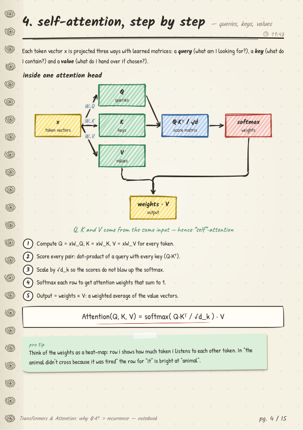
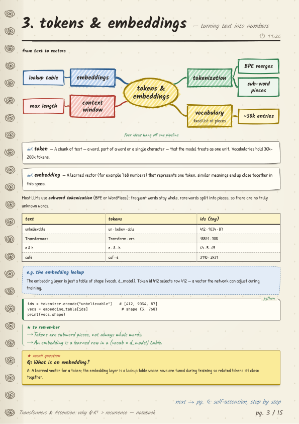
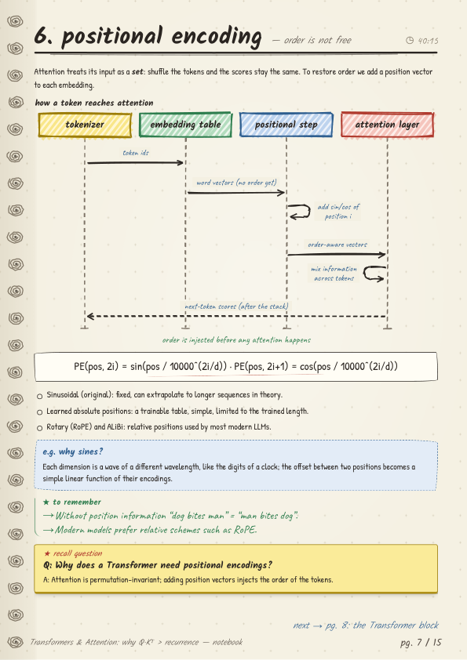

# Lecture Notes AI

Paste a YouTube lecture link, pick an AI provider, and get **knowledge-only study notes** drawn as a hand-made "field notebook" PDF: cream ruled paper, spiral rings, sketchy diagrams, yellow sticky *recall question* boxes, a glossary and a one-page recap. No "welcome back / like and subscribe / sponsor" filler - just what the lecture actually teaches.

| Flow diagram | Mind map | Sequence diagram |
|---|---|---|
|  |  |  |

Everything runs on your own computer. The only data that leaves it is the transcript text, sent to the AI provider *you* choose, using *your* key.

You can use it three ways, all backed by the same engine:

- a **web UI** (`backend/` + `frontend/`, runs on localhost),
- a **command line** (`python -m notes_engine URL ...`),
- a **Python library** (`import notes_engine`).

## Quick start

### Requirements

The commands below start with `cd lecture-notes-ai`; skip that line if you are already inside the project folder.

- Python 3.10 or newer.
- Microsoft Edge or Google Chrome (Edge ships with Windows). It is only used headless, to print the PDF. Without it you still get the HTML preview and the JSON.
- `ffmpeg` on your `PATH` - *only* needed for videos that have no captions (their audio is transcribed with Groq Whisper).

### Web UI (Windows, one click)

```powershell
cd lecture-notes-ai
powershell -ExecutionPolicy Bypass -File .\start.ps1
```

`start.ps1` creates `.venv`, installs the project (only when `pyproject.toml` changed), starts the server and opens <http://127.0.0.1:5055>. Paste a YouTube link (the video appears in an embedded player right away so you can check it is the right one), choose a provider, paste your API key, press **Generate notes**. When the notes are ready you can preview them and **Download PDF** or **Download JSON**.

Manual start (any OS):

```bash
cd lecture-notes-ai
python -m venv .venv
# Windows: .venv\Scripts\activate      macOS/Linux: source .venv/bin/activate
pip install -e ".[web]"
python backend/run.py        # http://127.0.0.1:5055
```

### Command line

```bash
cd lecture-notes-ai
pip install -e .
export GROQ_API_KEY=...      # PowerShell: $env:GROQ_API_KEY = "..."
python -m notes_engine "https://www.youtube.com/watch?v=VIDEO_ID" --provider groq --out notes.pdf --html --json
# or, after installing:  lecture-notes URL --provider groq --out notes.pdf
```

| Option | Meaning |
|---|---|
| `--provider` | `groq` (default), `gemini`, `xai`, `huggingface` |
| `--model` | model name; default is the provider's default model |
| `--out` | output PDF path (default `notes.pdf`) |
| `--html`, `--json` | also write `<out>.html` / `<out>.json` next to the PDF |
| `--api-key`, `--groq-key` | pass keys explicitly (the environment variable is safer: it stays out of shell history) |
| `--list-providers` | show providers, default models and key links |
| `-q` | no progress line |

Exit codes: `0` ok, `2` bad usage or missing key, `3` transcript error, `4` AI provider error, `5` notes made but the PDF could not be drawn (JSON and HTML are saved instead), `1` anything else. Keys are never printed.

### Python

```python
import notes_engine

result = notes_engine.generate(
    "https://youtu.be/VIDEO_ID", "groq",          # api_key falls back to $GROQ_API_KEY
    out_dir="out", progress=lambda stage, pct, msg: print(pct, msg),
)
result["pdf_path"], result["html_path"], result["notes"]   # notes = the Notes JSON dict
```

The building blocks are exported too: `parse_video_id`, `get_transcript`, `generate_notes`, `validate_notes`, `render_html`, `render_pdf`, the exceptions `IngestError`, `LLMError`, `PdfError`, and `PROVIDERS`.

## Providers and free API keys

| Provider | Get a key | Default model | Notes |
|---|---|---|---|
| Google Gemini | <https://aistudio.google.com/apikey> | `gemini-2.5-flash` | Generous free tier; large context |
| Groq | <https://console.groq.com/keys> | `openai/gpt-oss-120b` | Free tier, very fast. The same key transcribes audio (Whisper) for videos without captions |
| Hugging Face | <https://huggingface.co/settings/tokens> | `meta-llama/Llama-3.3-70B-Instruct` | Token needs permission to call *Inference Providers* |
| xAI Grok | <https://console.x.ai> | `grok-4` | Paid API |

Keys are looked up in this order: the key you type in the page / `--api-key` / `api_key=`, then the environment (`GEMINI_API_KEY`, `GROQ_API_KEY`, `XAI_API_KEY`, `HF_TOKEN`). For the web UI you can keep them on the server instead: copy `backend/.env.example` to `backend/.env` and fill in the ones you have. The page then shows **"Key found on server"**. `.env` is git-ignored.

## How it works

```
YouTube URL
   |
   v
ingest   captions (youtube-transcript-api) -> auto-captions (yt-dlp)
         -> audio + ffmpeg + Groq Whisper (only if no captions and a Groq key)     0-25 %
   |
   v
llm      short lecture: one call -> Notes JSON
         long lecture:  map-reduce (digest each slice -> compose sections
         -> glossary/recap) -> validate_notes() coerces & clamps the JSON          25-85 %
   |
   v
pdf      Notes -> self-contained HTML (inline fonts, hand-drawn SVG diagrams)
         -> headless Edge/Chrome -> A4 PDF                                         85-100 %
```

The web server (`backend/app/server.py`) runs each request as a background job (max 2 at a time), keeps its status in memory and writes `notes.json`, `notes.html` and `notes.pdf` to `backend/output/<job_id>/`. The page polls `/api/jobs/<id>` about once a second; job folders older than 24 hours are deleted at startup. If the PDF step fails (for example no Edge/Chrome) but the notes were written, you still get the preview and the JSON, plus a short warning.

### Notes format

The structured notes (sections, blocks, diagrams, recall questions, glossary, recap) are plain JSON, documented in [docs/notes-schema.md](docs/notes-schema.md). It is the contract between the LLM prompts, `validate_notes`, the renderer and the web UI.

### HTTP API (web UI)

| Method | Path | Purpose |
|---|---|---|
| GET | `/api/providers` | `{providers:[{id,label,default_model,key_hint,server_key}]}` (`server_key` is a boolean) |
| POST | `/api/jobs` | JSON `{url, provider, api_key?, model?, groq_key?}` -> `202 {job_id}` |
| GET | `/api/jobs/<id>` | `{status: queued/running/done/error, stage, pct, message, error?, meta?, links?, warning?}` |
| GET | `/api/jobs/<id>/notes.json` | the structured notes |
| GET | `/api/jobs/<id>/notes.pdf` | the PDF (download) |
| GET | `/api/jobs/<id>/notes.html` | the HTML preview |

## Tech stack

| Part | Used for |
|---|---|
| Python 3.10+, `requests` | Engine, plain HTTP calls to the providers (no vendor SDKs) |
| Flask, flask-cors, python-dotenv | Local web server and `.env` loading (`web` extra) |
| youtube-transcript-api | Captions and auto-captions |
| yt-dlp | Video metadata, caption fallback, audio download |
| ffmpeg | Splitting audio for transcription (only without captions) |
| Groq Whisper (`whisper-large-v3-turbo`) | Transcribing videos that have no captions |
| Gemini / Groq / Hugging Face / xAI | The LLMs that write the notes |
| Rough.js + hand-drawn SVG | Sketchy diagrams (flow, stack, compare, cycle, tree, timeline, mindmap, sequence) |
| Headless Edge / Chrome | HTML -> A4 PDF (set `LNAI_BROWSER` to pick a browser) |
| PyMuPDF | Text metrics for layout and PDF checks |
| Vanilla JS / CSS | The web page - no build step, works offline |
| pytest | Tests (all network and provider calls are mocked) |

## Project layout

```
notes_engine/              the self-contained engine package (pip-installable)
  __init__.py              generate(), re-exports
  __main__.py              command line
  ingest.py                YouTube -> transcript
  llm.py, prompts.py, notes_schema.py      providers, notes generation, validation
  pdf.py, templates/ (+ vendor/rough.js), static/fonts/    notebook renderer
backend/                   the web app: run.py, app/server.py, .env.example
frontend/                  index.html, app.js, styles.css
tests/                     pytest suites
docs/                      notes-schema.md, images/
start.ps1                  one-click launcher (Windows)
pyproject.toml             package metadata and extras
```

## Development

```bash
cd lecture-notes-ai
pip install -e ".[web,dev]"
python -m pytest
```

Set `LNA_OFFLINE=1` to skip the one live-network test. Set `FFMPEG_PATH` if `ffmpeg` is not on your `PATH`. The web server port can be changed with `LNA_PORT`.

## Limitations

- YouTube only. Private, age-restricted, members-only and live videos cannot be fetched without signing in.
- Videos without captions need a Groq key and `ffmpeg`.
- Very long lectures take several minutes and many provider calls; free tiers may hit rate limits (the engine waits and retries).
- The PDF needs Microsoft Edge or Google Chrome installed; the HTML and JSON do not.
- Notes are written by an AI model from the transcript. They can contain mistakes, and a video that is mostly visual (slides with little speech) yields thinner notes.
- `start.ps1` is Windows-only; on other systems start the server by hand (see above).

## Troubleshooting

- **"Could not reach the server"** - `run.py` is not running, or something else uses port 5055 (set another with `LNA_PORT`).
- **"No captions ... and no Groq key"** - the video has no subtitles. Add a free Groq key (under *Advanced options*, in `.env`, or `--groq-key`) so the audio can be transcribed; this also needs `ffmpeg`.
- **"This video has nothing to teach"** - it is a trailer, music video or promo; use a lecture, tutorial or talk.
- **Rate-limit / quota errors** - wait a minute, pick another provider, or use a smaller model.
- **Invalid key** - check you picked the matching provider; keys are not interchangeable.
- **No PDF, only the preview** - install Microsoft Edge or Google Chrome.
- Details of unexpected failures are printed in the server console (keys are redacted there).

## Privacy and security

- The web server binds to `127.0.0.1` only, answers only local host names, and allows cross-origin calls only from `localhost` / `127.0.0.1` pages.
- Your API key lives in server memory for the duration of one job. It is never written to disk, logged, or returned by the API; error messages are scrubbed of it.
- *Remember on this device* stores the key in your browser's `localStorage` **unencrypted**, per provider; untick it to forget. Do not use it on a shared computer.
- The transcript is sent to the provider you picked; read their data policy (free tiers may use data to improve models).
- The embedded player uses `youtube-nocookie.com`; its address is built only from the validated 11-character video id, and the page's Content-Security-Policy allows framing only `youtube-nocookie.com`, `youtube.com` and itself. The player is the one place the browser talks to YouTube directly (YouTube may set cookies once you press play).
- Responses carry `nosniff`, frame and CSP headers; the notes preview is shown with scripts disabled.
- Never commit a `.env` file or a key. `.env` is in `.gitignore`.

## License

MIT - see [LICENSE](LICENSE). Bundled fonts (Kalam, Patrick Hand, Caveat, JetBrains Mono) are under the SIL Open Font License and Rough.js under the MIT license; their licence files sit next to them in `notes_engine/static/fonts/` and `notes_engine/templates/vendor/`.
